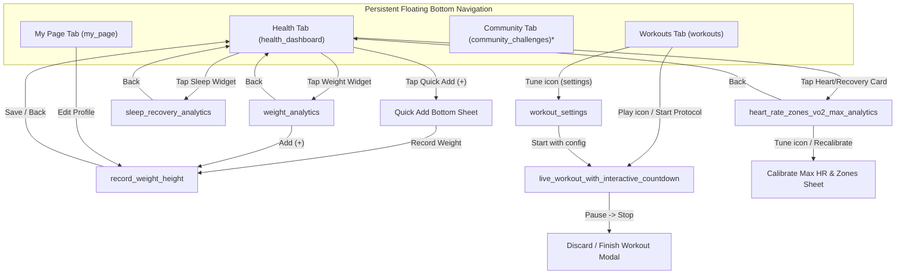

# DESIGN_ANALYSIS.md
**Project Name:** Nocturne (formerly exported as Lumina / Obsidian Kinetic Health Tracker)  
**Analysis Date:** November 20, 2026  
**Scope:** Complete read-only structural, visual, data contract, and Android/Capacitor readiness audit of the Stitch design exports.

---

## 1. Screen & Modal Inventory & Navigation Graph

The exported folder `stitch_lumina_health_fitness_tracker` contains **10 unique application screens**, **3 slide-over/bottom-sheet modals**, and **1 full-screen countdown overlay**.

### 1.1 Complete Screen & Modal Inventory

| # | Directory / Screen Name | Primary Role & UI Type | Modals / Bottom Sheets / Overlays Included |
|---|---|---|---|
| **1** | `health_dashboard` | Main App Tab: Health Overview & Daily Biometrics | **`#quick-add-modal` / `#quick-add-sheet`**: Bottom sheet to record weight/height, launch workout, log hydration. |
| **2** | `workouts` | Main App Tab: Workouts Hub & Protocols | Direct launch triggers for Outdoor Walking, Running, Cycling, and Tabata/HIIT. |
| **3** | `workout_settings` | Configuration View: Activity Targets & Coach Settings | Goal selectors (Distance, Time, Calorie, Steps), Audio/Haptic toggles, Dial Wheel parameter stepper. |
| **4** | `live_workout` | Active Workout Telemetry (Standard HUD) | **`#discardModal`**: Slide-up prompt asking "Discard current telemetry?" with Keep Going / Discard actions. |
| **5** | `live_workout_with_interactive_countdown` | Active Workout HUD with 3-2-1 Intro Overlay | **`#countdownOverlay`**: Fullscreen SVG ring countdown animation (3-2-1-GO!).<br>**`#discardModal`**: Workout pause & discard bottom-sheet confirmation. |
| **6** | `record_weight_height` | Biometric Entry & Wheel Calibration Screen | Day picker carousel, Weight dial (0.1 kg/lbs increments), Height slider (cm/ft-in). |
| **7** | `weight_analytics` | Historical Weight & Body Comp Deep-Dive | **`#settingsMenu`**: 3-dots popover (Weight Goals, Manage Data, Export CSV). Batch selection & delete bar (`#manageBar`). |
| **8** | `sleep_recovery_analytics` | Sleep Stages & Readiness Deep-Dive | Interactive Hypnogram (Awake, REM, Light, Deep), Sleep Score dial, HRV balance, Mood/Sleep Note trigger. |
| **9** | `heart_rate_zones_vo2_max_analytics` | Cardiovascular Fitness & HR Zones | **`#zone-modal-backdrop` / `#zone-modal-sheet`**: "Calibrate Max HR & Zones" modal with Tanaka / Gulati formulas, resting HR, and Zone 1–5 range recalculation. |
| **10** | `community_challenges` | Social & Community Rivalries Hub | Interactive high-five / cheer button (`#highFiveBtn`), Squad battle cards, Challenge leaderboard preview. |
| **11** | `my_page` | Profile, Goals, Health Connect & System Settings | Profile hero (Level, Streak, Workouts), Health Profile link, Goals, Units, Health Connect sync trigger. |

---

### 1.2 Navigation Graph & Link Map



### 1.3 Missing / Dead Links & UX Inconsistencies Flagged
1. **Inconsistent Tab Bar Count:**
   - `community_challenges` contains a **4-tab bar** (`Health`, `Workouts`, `Community`, `My page`).
   - `health_dashboard`, `workouts`, and `my_page` contain a **3-tab bar** (missing `Community`).
   - *Fix:* Unify the floating bottom bar across all main screens to include all 4 tabs consistently.
2. **Hardcoded Anchors (`href="#"`):**
   - In all exported files, bottom tabs, back buttons, and cards use dummy `href="#"` or unlinked tags.
3. **Dual Live Workout Screens:**
   - `live_workout` and `live_workout_with_interactive_countdown` are two variations of the same view. We will merge them into a single dynamic screen where countdown is triggered on session start.
4. **Quick-Add Metric Redirection:**
   - In `health_dashboard`, the `#open-record-weight-btn` in the quick-add sheet has a click listener but only shows an alert rather than routing to `record_weight_height`.

---

## 2. Design System & Theme Extraction ("Obsidian Kinetic")

The design system follows the **Obsidian Kinetic** specifications.

### 2.1 CSS Variables & Palette Tokens

```css
:root {
  /* Canvas & Surfaces (Obsidian Mineral Tone) */
  --color-surface: #111413;
  --color-surface-dim: #111413;
  --color-surface-bright: #373a38;
  --color-surface-container-lowest: #0c0f0e; /* Deep canvas base */
  --color-surface-container-low: #191c1b;
  --color-surface-container: #1d201f;        /* Standard card background */
  --color-surface-container-high: #282b29;
  --color-surface-container-highest: #323534;

  /* Typography & Foreground */
  --color-on-surface: #e1e3e1;               /* Primary high-contrast text */
  --color-on-surface-variant: #bccabb;       /* Secondary metrics / subtle text */
  --color-outline: #869486;                  /* Border hairpins */
  --color-outline-variant: #3d4a3e;          /* Glass border hairline */

  /* Kinetic Brand Accents (White - Light Green - Emerald Gradient) */
  --color-primary: #6bfb9a;                  /* Kinetic mint/light green */
  --color-primary-container: #4ade80;        /* Core neon green #4ADE80 */
  --color-primary-fixed: #6dfe9c;
  --color-secondary: #73db9a;
  --color-secondary-container: #00834b;
  --color-tertiary: #ffffff;                 /* High contrast pure white */
  --color-error: #ffb4ab;
  --color-error-container: #93000a;
}
```

### 2.2 Glassmorphism & Elevation Rims
- **Level 1 Cards:** Linear gradient from `#141A18` (top-left) to `#1C2420` (bottom-right) framed by `border: 1px solid rgba(255, 255, 255, 0.08)`.
- **Level 2 Modals / Sheets:** `background: rgba(25, 28, 27, 0.95); backdrop-filter: blur(20px); border-t: 1px solid rgba(255, 255, 255, 0.15)`.
- **Floating Bottom Bar:** `background: rgba(12, 15, 14, 0.85); backdrop-filter: blur(24px); border: 1px solid rgba(255, 255, 255, 0.1)`.
- **Active Halo Glow:** `box-shadow: 0 4px 20px rgba(74, 222, 128, 0.25)`.

### 2.3 Typography Specs
- **Display & Headlines:** `Plus Jakarta Sans`, font-weights `700`, `800`, `900`, tracking `-0.02em` to `-0.03em`.
- **Body & Tabular Telemetry:** `Inter`, font-weights `400`, `500`, `600`.
- **Tabular Numerics Rule:** Every dynamic counter, stopwatch, and heart rate MUST enforce `font-feature-settings: 'tnum'` (`font-variant-numeric: tabular-nums`) to prevent horizontal jitter.

### 2.4 Border Radii
- Pill Buttons / Chips: `rounded-full` (`9999px`)
- Standard Biometric Cards: `rounded-2xl` (`1.5rem` / `24px`) or `rounded-3xl` (`2rem` / `32px`)
- Modals & Sheets: `rounded-t-3xl` or `rounded-t-xl`

---

## 3. Dynamic Data & API Contract Mapping (Screen by Screen)

### 3.1 Health Dashboard (`health_dashboard`)
* **Hardcoded UI Items to Parameterize:**
  - `Kinetic Score`: Overall score (`82%`), Active minutes (`48 / 60 min`), Step counter (`8,420 / 10,000`), Calories burned (`520 / 650 kcal`).
  - `Weekly Routine`: 7-day checklist (Sunday to Saturday completion status).
  - Biometric quick cards: Weight trend (`68.4 kg`), Sleep duration (`7h 42m`), Resting Heart Rate (`54 bpm`).
* **User Actions:**
  - Tap `Quick Add (+)` -> open quick add bottom sheet.
  - Submit quick weight/height or hydration logs.
  - Tap card -> navigate to respective deep-dive analytics screen.
* **Proposed API Contract:**
```json
// GET /api/v1/dashboard/summary?date=2026-11-20
{
  "kineticScore": 82,
  "dailyMilestonePercentage": 84,
  "activeMinutes": { "current": 48, "target": 60 },
  "steps": { "current": 8420, "target": 10000, "aheadDelta": 1240 },
  "caloriesBurned": { "current": 520, "target": 650 },
  "weeklyRoutine": [
    { "day": "S", "date": 22, "completed": false },
    { "day": "M", "date": 23, "completed": true },
    { "day": "T", "date": 24, "completed": true },
    { "day": "W", "date": 25, "completed": true },
    { "day": "T", "date": 26, "completed": false },
    { "day": "F", "date": 27, "completed": true },
    { "day": "S", "date": 28, "completed": false }
  ],
  "recentVitals": {
    "weightKg": 68.4,
    "sleepHoursFormatted": "7h 42m",
    "sleepScore": 88,
    "restingHeartRateBpm": 54
  }
}
```

---

### 3.2 Weight & Height Recording (`record_weight_height`)
* **Hardcoded UI Items to Parameterize:**
  - Date carousel (Days M-S, highlighted active selection).
  - Current weight display (`69.0 kg` / lbs conversion toggle).
  - Weight delta tag (`-0.4 kg vs last week`).
  - Height dial slider (`178 cm` / ft-in conversion toggle).
* **User Actions:**
  - Drag or tap `+` / `-` steppers on weight ruler.
  - Slide height control range.
  - Toggle unit `kg <-> lbs` and `cm <-> ft/in`.
  - Tap `Save` to commit biometric entry.
* **Proposed API Contract:**
```json
// POST /api/v1/biometrics/log
// Request:
{
  "recordedAt": "2026-11-20T07:30:00Z",
  "weightKg": 69.0,
  "heightCm": 178.0,
  "isFasting": true,
  "notes": "Morning measurement"
}
// Response:
{
  "status": "success",
  "logId": "bio_99214",
  "bmi": 21.78,
  "deltaVsLastWeekKg": -0.4
}
```

---

### 3.3 Weight Analytics (`weight_analytics`)
* **Hardcoded UI Items to Parameterize:**
  - Timeframe filter (`Day`, `Week`, `Month`, `Year`).
  - Average weight (`68.4 kg`), BMI (`21.6 Normal`), Net change (`-1.4 kg this month`).
  - Target weight (`67.0 kg`, remaining delta `1.4 kg over goal`).
  - SVG historical trend chart (Data coordinates for weight curve & target reference dashed line).
  - Batch management checklist: items list with dates, values, and delete selection.
* **User Actions:**
  - Select timeframe filter tab.
  - Tap `Manage data` -> toggle checkbox mode.
  - Select items & tap `Delete selected`.
  - Tap `Add (+)` -> redirect to `record_weight_height`.
* **Proposed API Contract:**
```json
// GET /api/v1/analytics/weight?timeframe=month
{
  "timeframe": "month",
  "dateRangeFormatted": "Nov 1 – Nov 30, 2026",
  "averageWeightKg": 68.4,
  "bmi": 21.6,
  "bmiCategory": "Normal",
  "deltaKg": -1.4,
  "goalWeightKg": 67.0,
  "remainingToGoalKg": 1.4,
  "history": [
    { "id": "w1", "date": "2026-11-01", "weightKg": 69.8 },
    { "id": "w2", "date": "2026-11-08", "weightKg": 69.2 },
    { "id": "w3", "date": "2026-11-15", "weightKg": 68.7 },
    { "id": "w4", "date": "2026-11-20", "weightKg": 68.4 }
  ]
}
```

---

### 3.4 Sleep & Recovery Deep-Dive (`sleep_recovery_analytics`)
* **Hardcoded UI Items to Parameterize:**
  - Sleep Score (`88/100`), Qualitative text ("Optimal Recharge"), Efficiency (`92%`).
  - Total Duration (`7h 42m`), Sleep onset latency (`14m`).
  - Prime Readiness index (`92%`) with narrative advice.
  - Sleep Architecture hypnogram (Timestamped segments: Awake, REM, Light, Deep).
  - Stage duration breakdown: Deep (`1h 38m - 21%`), REM (`1h 55m - 25%`), Light (`3h 45m - 49%`), Awake (`24m - 5%`).
* **User Actions:**
  - Date pagination (`chevron_left` / `chevron_right`).
  - Tap `Log Sleep Note & Mood`.
  - Share sleep summary card.
* **Proposed API Contract:**
```json
// GET /api/v1/analytics/sleep?date=2026-11-20
{
  "date": "2026-11-20",
  "sleepScore": 88,
  "readinessScore": 92,
  "readinessMessage": "Your cardiovascular and nervous systems are fully restored. You are primed for high-intensity training.",
  "durationMinutes": 462,
  "efficiencyPercentage": 92,
  "onsetLatencyMinutes": 14,
  "stages": {
    "deep": { "minutes": 98, "percentage": 21, "benchmarkDeltaMin": 12 },
    "rem": { "minutes": 115, "percentage": 25, "benchmarkDeltaMin": 5 },
    "light": { "minutes": 225, "percentage": 49, "benchmarkDeltaMin": -10 },
    "awake": { "minutes": 24, "percentage": 5, "benchmarkDeltaMin": -7 }
  },
  "hypnogram": [
    { "time": "23:15", "stage": "light" },
    { "time": "23:45", "stage": "deep" },
    { "time": "01:30", "stage": "rem" },
    { "time": "03:45", "stage": "deep" },
    { "time": "06:00", "stage": "rem" },
    { "time": "07:05", "stage": "awake" }
  ]
}
```

---

### 3.5 Heart Rate Zones & VO2 Max Analytics + Calibration Modal (`heart_rate_zones_vo2_max_analytics`)
* **Hardcoded UI Items to Parameterize:**
  - Estimated VO2 Max (`49 mL/kg/min`, `Top 10%`, Fitness Age `22 yrs`).
  - 90-day VO2 trajectory (`+1.8 mL/kg/min`).
  - Resting HR (`54 bpm`), Nightly HRV (`68 ms`).
  - 5-Zone Heart Distribution (Time in Zone 1 to Zone 5, % breakdown).
  - **Calibrate Max HR & Zones Modal:** User age (`28`), Resting HR (`54`), Max HR (`192`), Formula selector (`Tanaka (208 - 0.7*age)`, `Gulati (206 - 0.88*age)`, `Custom`).
* **User Actions:**
  - Switch timeframes (`Day`, `Week`, `Month`, `6M`).
  - Click tune button to open `#zone-modal-sheet`.
  - Adjust Age, RHR, or Formula in modal -> real-time recalculation of Zones 1–5.
  - Save calibrated HR zones.
* **Proposed API Contract:**
```json
// GET /api/v1/analytics/cardio
{
  "vo2Max": 49.0,
  "vo2MaxTier": "Superior",
  "vo2MaxRank": "Top 10%",
  "fitnessAge": 22,
  "restingHrBpm": 54,
  "nightlyHrvMs": 68,
  "zones": [
    { "zone": 1, "name": "Recovery", "minBpm": 96, "maxBpm": 115, "minutesSpent": 24 },
    { "zone": 2, "name": "Aerobic Base", "minBpm": 116, "maxBpm": 134, "minutesSpent": 35 },
    { "zone": 3, "name": "Tempo", "minBpm": 135, "maxBpm": 153, "minutesSpent": 15 },
    { "zone": 4, "name": "Threshold", "minBpm": 154, "maxBpm": 172, "minutesSpent": 8 },
    { "zone": 5, "name": "Peak", "minBpm": 173, "maxBpm": 192, "minutesSpent": 2 }
  ],
  "calibration": {
    "age": 28,
    "restingHr": 54,
    "maxHr": 192,
    "method": "tanaka"
  }
}
```

---

### 3.6 Workouts Hub & Settings (`workouts` & `workout_settings`)
* **Hardcoded UI Items to Parameterize:**
  - Weekly workout summary (`3 sessions • 2h 45m`).
  - Featured Workout Protocol (`Kinetics HIIT Blast`, 24 min, 340 kcal).
  - Activity catalog (`Walking`, `Running`, `Cycling`) with last session stats (e.g., `3.4 km`, `11'40"/km pace`).
  - Settings parameters: Target Goal (`Distance: 5.00 km`, `Duration: 10 min`, `Calories: 100 kcal`, `Steps: 1,500`), Voice reminders, Auto-pause toggle, HR Zone vibration threshold.
* **User Actions:**
  - Select Activity & Goal type.
  - Use dial wheel stepper to set target distance/duration.
  - Toggle Voice/Haptic reminders and Auto-Pause.
  - Tap `Start Protocol` or `Play` -> launches countdown & live workout HUD.
* **Proposed API Contract:**
```json
// GET /api/v1/workouts/config
{
  "weeklyStats": { "sessionCount": 3, "totalMinutes": 165 },
  "selectedActivity": "running",
  "goal": { "type": "distance", "value": 5.0, "unit": "km" },
  "coaching": {
    "voiceCoachEnabled": true,
    "distanceReminderKm": 1.0,
    "durationReminderMin": 10,
    "hrZoneAlertThreshold": 4,
    "autoPauseEnabled": true
  }
}
```

---

### 3.7 Live Workout HUD + Countdown (`live_workout_with_interactive_countdown`)
* **Hardcoded UI Items to Parameterize:**
  - Interactive Countdown: 3, 2, 1, GO! audio/vibrations.
  - Live elapsed stopwatch timer (`00:24:38`).
  - Real-time GPS distance (`4.82 km`), Current Pace (`5'12" /km`), Average Pace (`5'18" /km`).
  - Real-time Heart Rate (`158 bpm`) & Active Zone Indicator (`Zone 4 Threshold`).
  - Active Burn calories (`342 kcal`), Cadence (`168 spm`).
  - Route name (`Riverside Loop Trail`), Elevation (`+45m`).
* **User Actions:**
  - Long press `Hold 3 seconds to unlock` (prevent accidental touch during run).
  - `Pause` / `Resume` workout.
  - Tap `Stop` -> open `#discardModal` (Keep Going vs Finish & Save).
* **Proposed API Contract:**
```json
// POST /api/v1/workouts/session/start -> returns { "sessionId": "sess_8812" }
// WebSocket / Telemetry Sync (or Health Connect batching):
{
  "sessionId": "sess_8812",
  "elapsedSeconds": 1478,
  "distanceMeters": 4820,
  "currentPaceSecPerKm": 312,
  "heartRateBpm": 158,
  "activeCalories": 342,
  "cadenceSpm": 168
}
```

---

### 3.8 Community Challenges (`community_challenges`)
* **Hardcoded UI Items to Parameterize:**
  - Featured Challenge (`October Century Rider 100km`, 4 Days Left, 4,820 active riders).
  - User milestone (`78.4 / 100 km`, `78% complete`, `21.6 km to victory`).
  - Active Rivalry step battle (`You: 18,420` vs `Marcus C.: 17,910`).
  - High-Five cheer button counter (`18` cheers).
* **User Actions:**
  - Tap High-Five cheer (`#highFiveBtn`) -> increment count & show micro-haptic.
  - Tap `Log 5km Ride`.
  - Tab filters (`Active (3)`, `Leaderboards`, `Clubs & Squads`).
* **Proposed API Contract:**
```json
// GET /api/v1/community/challenges
{
  "featuredChallenge": {
    "id": "chal_century_100",
    "title": "October Century Rider 100km",
    "daysRemaining": 4,
    "totalParticipants": 4820,
    "userProgress": { "completedKm": 78.4, "targetKm": 100.0, "percentage": 78 }
  },
  "rivalries": [
    {
      "id": "riv_1",
      "type": "Step Battle",
      "userScore": 18420,
      "opponentName": "Marcus C.",
      "opponentScore": 17910,
      "lead": 510,
      "cheersCount": 18
    }
  ]
}
```

---

### 3.9 My Page / Profile (`my_page`)
* **Hardcoded UI Items to Parameterize:**
  - User profile name (`Sankalp S`), Level (`Lvl 14`), Member status (`Kinetics Pro`).
  - Lifetime metrics: `142 Workouts`, `86 h Active`, `18 Days Streak`.
  - Biometrics summary: `174 cm • 62.5 kg • 28 yrs • Female`.
  - Daily Movement Goals: `60m Active • 10k Steps • 650 kcal`.
  - Sync status: `Cloud Sync (Just now)`, `Google Health Connect (Connected)`.
* **User Actions:**
  - Tap `Edit profile`.
  - Tap `Sync Now` (triggers cloud refresh & Health Connect sync).
  - Tap `Units of Measurement` (Metric vs Imperial).
  - Tap `Log Out`.
* **Proposed API Contract:**
```json
// GET /api/v1/user/profile
{
  "userId": "usr_sankalp",
  "displayName": "Sankalp S",
  "membershipTier": "Pro",
  "level": 14,
  "stats": { "workouts": 142, "activeHours": 86, "streakDays": 18 },
  "biometrics": { "heightCm": 174, "weightKg": 62.5, "age": 28, "gender": "female" },
  "goals": { "activeMinutes": 60, "steps": 10000, "calories": 650 },
  "integrations": { "healthConnect": true, "lastSyncedAt": "2026-11-20T19:15:00Z" }
}
```

---

## 4. Web-to-Android Studio (Capacitor) Readiness Check

Wrapping web code into an Android APK / AAB via Capacitor requires resolving several items present in the raw Stitch exports:

| Issue in Stitch Files | Why it Fails on Android | Solution for Nocturne App |
|---|---|---|
| **1. External CDN Tailwind (`https://cdn.tailwindcss.com`)** | In Capacitor, app bundles run locally (`capacitor://localhost`). External CDN scripts will fail when offline, block launch, and trigger Content Security Policy (CSP) errors. | Install **Tailwind CSS v3** as a build-time dependency in Vite/React. |
| **2. Google Fonts & Material Symbols CDN Links** | Google Fonts (`Inter`, `Plus Jakarta Sans`, `Material Symbols Outlined`) won't render when user has no internet (e.g. running outside). | Self-host fonts in the frontend assets bundle and use Lucide React or local SVG icon components. |
| **3. Mobile Safe Area & Notch Insets** | Stitch designs use fixed padding (`pt-6`, `pb-24`) without `env(safe-area-inset-top)` or `env(safe-area-inset-bottom)`. The status bar and Android gesture pill will overlap headers and bottom navigation. | Use `@capacitor/status-bar` and CSS `pt-[env(safe-area-inset-top,24px)]` and `pb-[calc(env(safe-area-inset-bottom,16px)+80px)]`. |
| **4. Hardcoded Viewport Restrictions** | Some Stitch files define `max-w-md mx-auto` or desktop layout wrappers. | Use full mobile viewport (`w-full min-h-screen`) with fluid touch-first responsiveness. |
| **5. Monolithic HTML Files vs Component Architecture** | Each Stitch screen is an isolated 1,000-line static HTML file with duplicated script logic for modals, icons, and navigation. | Convert into a unified **React + TypeScript + Vite + Tailwind** SPA with reusable component libraries (Rings, Cards, Nav, Modals). |
| **6. Android Hardware Back Button Handling** | Native Android users expect the hardware back button or swipe-to-back gesture to close open bottom sheets (e.g., Quick Add, HR Zone sheet) before exiting the app. | Bind `@capacitor/app` `backButton` listener to modal state stacks. |
| **7. Haptics & Background Workout Audio** | Standard web browsers cannot trigger device haptics or keep workout timers alive when the screen sleeps. | Integrate `@capacitor/haptics` and Android Foreground Service for live workout tracking. |

---

## 5. Next-Step Architecture Plan (Monorepo)

To ensure smooth conversion to Android Studio via Capacitor, we recommend a modular monorepo structure:

```
Health Care App/
├── Logo,.png                                # Official high-res app icon
├── DESIGN_ANALYSIS.md                       # This comprehensive audit
├── stitch_lumina_health_fitness_tracker/    # Raw reference Stitch source files
│
├── frontend/                                # React 19 + TypeScript + Vite + Tailwind CSS
│   ├── src/
│   │   ├── assets/                          # Local fonts, logo, sound effects
│   │   ├── components/
│   │   │   ├── common/                      # GlassCard, PillButton, DialWheel, Hypnogram
│   │   │   ├── navigation/                  # FloatingBottomNav, TopAppBar
│   │   │   └── modals/                      # QuickAddModal, CalibrateZonesModal, DiscardModal
│   │   ├── screens/                         # 1-to-1 conversion of all 10 Stitch views
│   │   ├── services/                        # API client, Health Connect bridge, local DB (Dexie)
│   │   ├── store/                           # State management (Zustand)
│   │   ├── theme/                           # Obsidian Kinetic design tokens
│   │   ├── App.tsx                          # React Router configuration
│   │   └── main.tsx
│   ├── capacitor.config.ts                  # Capacitor Android settings (App ID: com.nocturne.health)
│   ├── tailwind.config.js                   # Custom Obsidian Kinetic theme palette
│   └── package.json
│
├── backend/                                 # Lightweight Node.js/Express or Fastify API
│   ├── src/
│   │   ├── controllers/                     # Biometrics, Workouts, Cardio, Sleep, Challenges
│   │   ├── routes/                          # REST endpoints matching section 3 contracts
│   │   ├── models/                          # SQLite / Prisma / In-memory data store
│   │   └── server.ts
│   └── package.json
│
└── android/                                 # Capacitor-generated native Android Studio project
    ├── app/
    │   ├── src/main/res/                    # App icons generated from Logo,.png
    │   └── src/main/AndroidManifest.xml     # Health Connect, GPS, and Haptics permissions
    └── build.gradle
```

---

## 6. Execution Status & Next Actions

> [!NOTE]
> All files in the Stitch folder have been read and inspected without altering any source code.

**Awaiting User Confirmation:**
Please review this analysis. Upon your approval, we will proceed to:
1. Initialize the `/frontend` Vite + React + Tailwind project with the **Obsidian Kinetic** theme.
2. Generate all 10 interactive screens and modals with 100% fidelity to the Stitch design.
3. Configure Capacitor and sync to the `/android` Android Studio project with your custom `Logo,.png` configured as the app icon!
