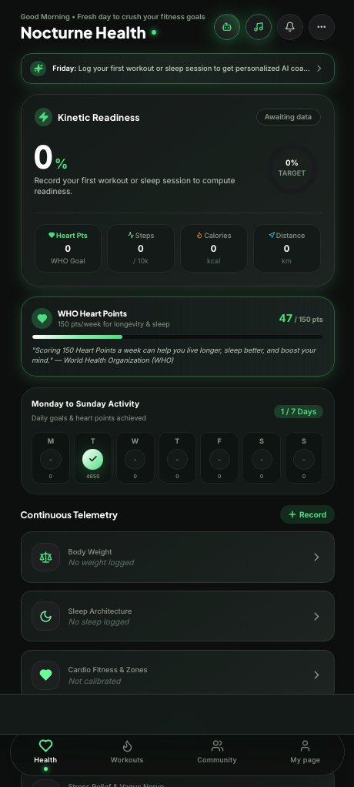
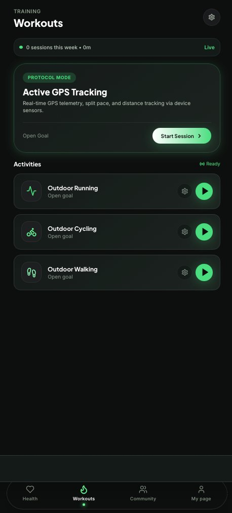
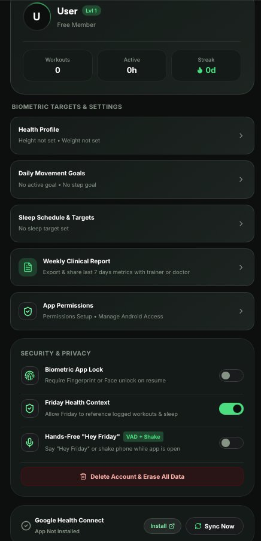

# Nocturne — Obsidian Kinetic Health & Fitness

<div align="center">

[](https://github.com/Sankalp28Roop/Nocturne-Health-/actions/workflows/ci.yml)
[](https://opensource.org/licenses/MIT)
[](https://www.typescriptlang.org/)
[](https://react.dev/)
[](https://capacitorjs.com/)
[](https://tailwindcss.com/)

</div>

Nocturne is an advanced, offline-first health, biometric, and endurance tracking application designed with an **Obsidian Kinetic** aesthetic (deep obsidian canvas `#0c0f0e`, crisp white typography, and vibrant energetic light green `#6bfb9a` accents).

It delivers comprehensive biometric telemetry, live GPS workout tracking with route privacy protection, multimodal AI meal scanning, stress-reduction breathwork, and clinical report exports—backed by a zero-fake-data guarantee.

---

## App Previews & Core Screens

<div align="center">
  
  
  
</div>

<br/>

### 1. Health Dashboard (`dashboard.jpg`)
* **Purpose**: Primary command center for daily health telemetry and biometric readiness.
* **Key Components & Features**:
  - **Dynamic Greeting & Friday AI Insight Pill**: Time-aware status with quick AI coach advice ("Log your first workout or sleep session...").
  - **Kinetic Readiness Score**: Computes physical recovery and training readiness based on logged sleep, resting heart rate, and training load.
  - **WHO Heart Points Gauge**: Tracks weekly cardio intensity points (target: 150 pts/week) based on World Health Organization cardiovascular longevity guidelines.
  - **Monday–Sunday Activity Tracker**: 7-day visual consistency matrix showing completed step, calorie, and cardio goals.
  - **Continuous Telemetry Cards**: Direct access to deep-dive analytics for Body Weight & Height trends, Sleep Architecture (Hypnograms), Cardio Fitness & 5-Zone HR calibration, and Stress Relief / Box Breathing.
  - **Quick Add Action Button (`+ Record`)**: Instantly log weight, record a meal via photo/text, log sleep, or launch breathwork.

---

### 2. Workouts Section (`workouts.jpg`)
* **Purpose**: Outdoor and indoor athletic session tracking powered by real-time GPS telemetry and audio-cued countdowns.
* **Key Components & Features**:
  - **Weekly Training Volume**: Displays completed sessions and total active minutes for the current calendar week.
  - **Active GPS Tracking Banner**: One-tap quick launch for endurance sessions using device location hardware and split-pace calculations.
  - **Pre-Configured Activity Profiles**:
    - **Outdoor Running**: Live distance, cadence, split pace, heart rate zones, and GPS breadcrumb trail.
    - **Outdoor Cycling**: High-speed velocity telemetry, elevation gain, and distance tracking.
    - **Outdoor Walking**: Step cadence, active burn, and low-impact cardiovascular tracking.
  - **Post-Workout Route Privacy**: Includes the custom Privacy Slider (50m–1500m) to mask start and end coordinates before sharing workouts publicly.

---

### 3. Profile, Settings & Biometric Targets (`settings.jpg`)
* **Purpose**: Personalized biometric configuration, clinical exports, system permissions, and security controls.
* **Key Components & Features**:
  - **Member Status & Streak Badge**: Shows current athlete level, lifetime completed workouts, active hours, and day streak.
  - **Biometric Targets & Settings**:
    - **Health Profile**: Configures baseline height, weight, age, and biological sex for VO2 Max and calorie math.
    - **Daily Movement Goals**: Sets custom targets for daily steps and active calorie expenditure.
    - **Sleep Schedule & Targets**: Defines bedtimes, wake windows, and nightly duration targets.
  - **Weekly Clinical Report**: One-tap generator that aggregates 7 days of heart rate, weight, steps, and sleep into an exportable CSV and shareable doctor summary.
  - **App Permissions Hub**: Transparent Android access manager for Camera, Location (GPS), Microphone, and Physical Activity recognition.
  - **Security & Privacy Controls**:
    - **Biometric App Lock**: Protects personal health data behind fingerprint or Face Unlock on resume.
    - **Friday Health Context Toggle**: Granular permission controlling whether Friday AI can reference health logs during chat.
    - **Hands-Free "Hey Friday" (VAD + Shake)**: Voice activity detection and shake-to-ask shortcuts.
    - **Delete Account & Erase All Data**: Full GDPR/CCPA compliant data wipe.
  - **Google Health Connect**: Cross-app synchronization for unified Android health metrics.

---

## Technical Architecture

```text
├── backend/                  # Node.js, Express, TypeScript, Prisma ORM
│   ├── prisma/               # Schema with MealLog, BreathingSession, WorkoutSession
│   ├── src/
│   │   ├── controllers/      # Health analytics, workouts, AI chat, nutrition
│   │   ├── middleware/       # JWT auth, rate limiting, Zod validation
│   │   ├── routes/           # REST endpoints (/auth, /dashboard, /nutrition, etc.)
│   │   └── server.ts         # Express entry point (Port 4000)
│   └── .env.example          # Backend environment variables
├── frontend/                 # React 19, TypeScript, Vite, Tailwind CSS, Lucide
│   ├── src/
│   │   ├── components/       # Obsidian Kinetic cards, modals, navigation
│   │   ├── screens/          # Dashboard, Workouts, Breathing, Weight, Analytics
│   │   ├── services/         # Offline sync engine, API client, haptics
│   │   └── stores/           # Zustand state management
│   └── .env.example          # Frontend environment variables
├── android/                  # Native Android Capacitor wrapper (Gradle / Kotlin)
├── docs/screenshots/         # Verified UI screenshots
├── .gitignore                # Clean production git ignore
└── README.md                 # Full documentation
```

---

## Quick Start Guide

### 1. Backend Server
```bash
cd backend
cp .env.example .env
npm install
npx prisma db push
npm run dev
```
Backend runs on `http://localhost:4000`.

### 2. Frontend Client
```bash
cd frontend
cp .env.example .env
npm install
npm run dev
```
Frontend runs on `http://localhost:5173`.

### 3. Android Mobile Sync (Optional)
```bash
cd frontend
npm run build
npx cap sync android
```
Open `./android` in Android Studio or compile directly with `./gradlew assembleDebug`.
